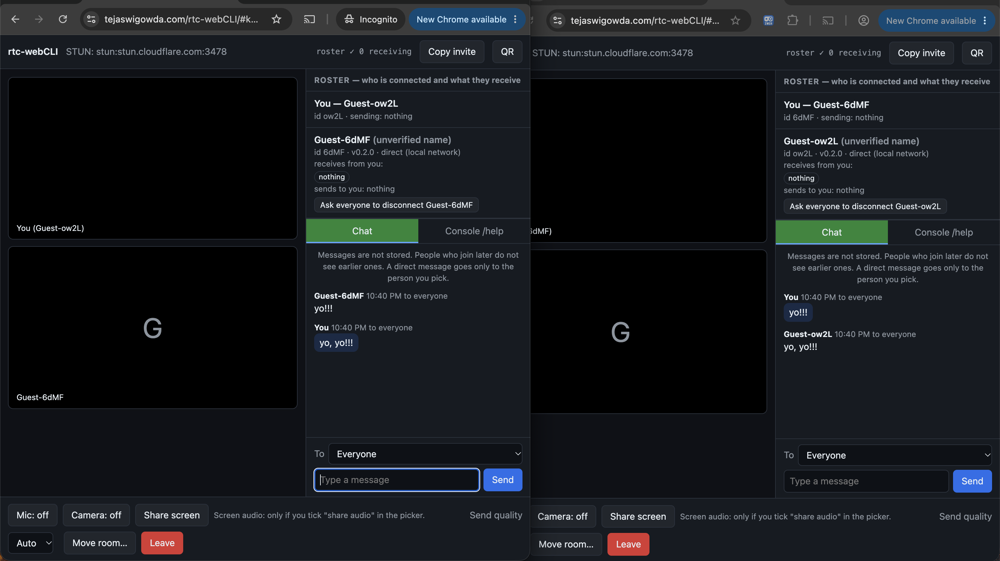
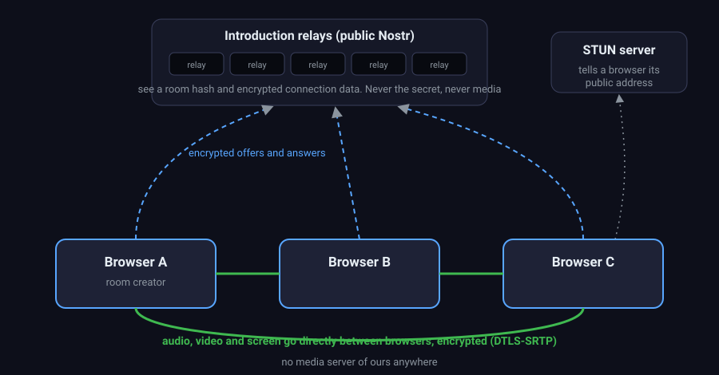
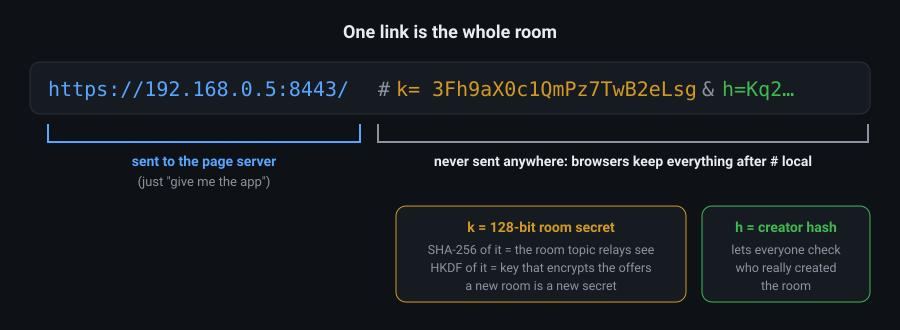
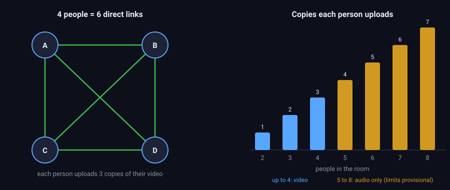
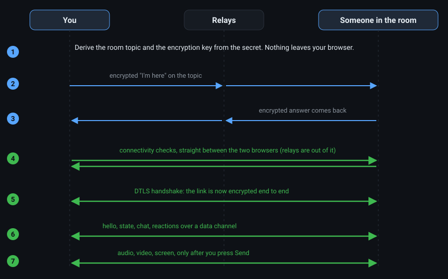
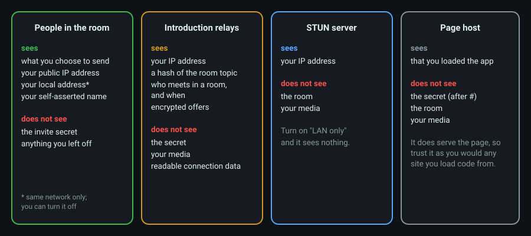
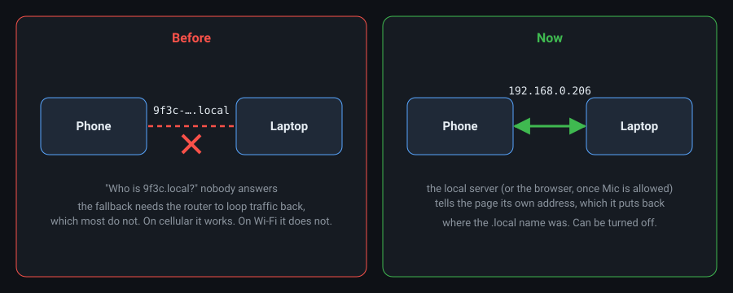

# rtc webCLI

A browser-based room for audio, video and screen share, opened with an invite link. **Link in, live call out.** <b><ins>No accounts, and no media server of ours. Audio, video and screen go directly between participants</ins></b> (unless you add your own TURN server), encrypted, using WebRTC and [Trystero](https://github.com/dmotz/trystero) for introductions.



▶ **Live app:** https://tejaswigowda.com/rtc-webCLI/

> Part of the **webCLI** family of browser tools. Same look and feel, same discipline about what leaves your device, with one difference stated up front: **a call has to send**. Your media goes to the other people in the room, and the introduction relays and a STUN server are contacted to set that up. Every host is listed in the [egress table](#privacy--egress), and nothing is claimed beyond it.

<p align="center"></p>

**Read more, with diagrams: [the About page](docs/about.html)** (also served at `/about.html`).

**Status: v0.3.0 (protocol 3): not yet run on real devices. On v0.2.0 (2026-11-21): two runs pass, one fails** (see the [RT22 matrix](#tests-and-gates)). Checks that code can make are automated (`npm test`), but they run against a **mock relay** with fake cameras, not against the real public relays or real networks. The cap measurement and most of the device matrix are open, and listed under [Tests and Gates](#tests-and-gates) rather than hidden.

---

## Paper

This tool follows the **Web-CLI** architecture, described in:

> **The Web-CLI: Verifiable Privacy for Tools, Models, and Inference Engines in the Browser**
> Tejaswi Gowda, Arizona State University.
> arXiv: https://arxiv.org/abs/2608.28950

The paper defines the four properties (fidelity, progressive disclosure, offline-first, zero egress). This tool cannot be zero-egress, because a call has to send. It keeps the part that still applies: every request is declared and checkable in DevTools, and the exceptions are named instead of implied.

---

## At a Glance

| | |
|---|---|
| **in** | an invite link (or create a room), plus your camera, microphone or screen if you choose to share them |
| **out** | a live peer-to-peer call; no file or artifact |
| **not** | a hosted meeting service. No server relays media, so there is no enforceable host, no cloud recording, no waiting room and no large rooms |
| **egress** | your media: only to the people in the room. Setup: the introduction relays and STUN server listed below |
| **fetches** | code: none from a CDN (self-hosted, hash-pinned); relays and STUN per the egress table |
| **repro** | not applicable |

There is no `run=` agent surface and no `window.__webcli_result` yet.

---

## The invite link

<p align="center"></p>

Everything after the `#` stays in your browser. A new room is a new secret; there is no room name, list or account.

---

## Key Features

- **Invite-Link Rooms**: `https://<origin>/#k=<128-bit secret>&h=<creator hash>`. Everything lives after the `#`, which browsers never send to a server. A new room is a new secret; there is no other room identity

- **Audio, Video and Screen Share**: one WebRTC connection per other person (a mesh), encrypted with DTLS-SRTP. No account

- **Media-Off Join**: camera and microphone stay off until you turn them on, and each starts with a local preview that nobody can see until you press Send

- **A Roster You Can Trust**: every connection that carries your media is listed, with what it receives (video, audio, screen, or "unlabelled media"). Membership follows live senders, not connection state, so a connection that is only "disconnected" for a moment stays listed. The top bar shows a check that is made independently of how the roster is built: it reads the rendered roster back and fails if any receiving connection, or any kind of media it receives, is missing

- **Loud Failures**: if a pair of people cannot connect within 15 seconds, the roster lists it with the reason class (no candidates, ICE failed, DTLS failed) and the kinds of addresses each side offered; the same line goes to the console. There is no separate banner for it. If someone announces themselves in the room but no answer ever arrives, that is named too ("no answer"). No endless spinner

- **Empty vs. Broken**: "No one else is here yet", "Someone is trying to connect…", "The introduction servers are connected but not passing messages" and "Can't reach the introduction servers" are four different messages, so nobody waits forever on a dead relay. "Reachable" means a relay returned a test event, not merely that a socket opened

- **Hard Caps With Refusal**: a room has a person limit and a video limit. The person who would exceed it gets a screen naming the cap and the reason, and is disconnected from everyone, never half-admitted. Video seats go to the first people to join, even with their camera off. The caps are provisional and **not yet measured**

- **Honest Quality**: when your uplink is short, the page lowers your send resolution and says so, separately for the camera and a screen share ("Sending 360p to 4 people. Sharing screen at 540p to 4 people"). The uplink figure is an estimate, and is labelled as one

- **Honest Removal**: "Ask everyone to disconnect X" asks each person, who can **Disconnect** or **Ignore**; nothing happens to you unless you agree. Anyone in the room can send that request, and a removed person can simply reconnect: in testing the library re-dialled a closed pair within about ten seconds. When that happens the roster says "reconnected after a request to disconnect them" and the request is not re-applied. **Move room** (new secret, chosen people re-invited over the encrypted connection) is the only real removal

- **Chat**: a Chat tab beside the roster, in the style of a meeting chat: messages to everyone or a direct message to one person, sender and time on each message, an unread count on the tab. Messages stay in memory only, so people who join later do not see earlier ones. Names are self-asserted; the room creator is marked, because that can be proved

- **Recording, creator only**: whoever created the room (the browser holding the key behind the invite) gets a **Record** button; nobody else does. The recording is made in that browser and saved to that device, including everyone's video, audio and shared screens as the creator sees them. Chat is not recorded. Before it starts the creator confirms what is captured. Everyone else is told in their own window: a banner for as long as it runs, a notice with **Stay** or **Leave** when it starts (also for people who join late), a tag in the roster, and a message in the chat. Peers accept a "recording" message only from the peer that proved it is the creator

- **Device Control**: **Devices…** lists cameras, microphones and (where the browser allows it) speakers, with a microphone level meter and a speaker test sound. Changing the camera or microphone while live swaps the track on every connection without dropping the call. **Flip camera** cycles cameras on a phone. If a device is unplugged or taken by another app, the page says so and stops that stream. A blocked or busy camera gets plain-language help for each browser instead of a bare error. Your choices are remembered

- **Works on a Phone**: the same header as the other webCLIs (logo, "peer-to-peer" and "No media server" tags, and book, info and GitHub icons), and the family colour palette. Every control is an icon with a label that collapses to the icon alone on small screens, with 44 px touch targets and Leave always on screen. On a phone the video grid is the main view; a chat button swaps it for the roster, chat and console, and a **More** button holds layout, send quality and Move room. Dialogs slide up from the bottom, inputs are sized so iOS does not zoom, and the screen's safe areas are respected. The About page is responsive too

- **Layout**: tiles show who is speaking (a green outline, computed in your browser from each person's audio) and who is muted. **Grid** or **Speaker** layout; **Pin** (spotlight) any tile; **Full screen** on a tile (button or double-click); your own camera view can be mirrored (others always see it unmirrored)

- **Hand, Reactions, Sounds, Timer**: raise or lower a hand (a hand on your tile, a line in chat, a soft sound); send a reaction (👍 👏 ❤️ 😂 😮 🎉) that floats over your tile; soft sounds for new messages, hands, joins and leaves (can be turned off); a timer shows how long you have been in the room; the tab title shows unread messages

- **Stays Connected**: the screen is kept awake during a call where the browser allows it. If the link to someone drops, the page says "Reconnecting…", the library re-dials by itself, and your camera and microphone resume without any action (tested). If you go offline, the page says so

- **Same-Network Connections**: browsers hide each device's local address behind a `.local` name that other devices often cannot resolve. The page puts your real local address back into what it sends to peers, so people on the same Wi-Fi can connect directly. **When the page is served by `server.js`, this works from the start. On a static host (including the live site), it takes effect once you allow microphone access, which is what lets the browser reveal your local address. When a pair fails with hidden `.local` addresses, the roster entry has an **Allow local connections** button (also `/localfix`): the browser asks for the microphone once, the page reads your local address and releases the device at once, and the connection retries by itself, usually within a minute. Turning on Mic does the same.** On by default, disclosed before you first join (with the address that would be shared), and can be turned off (`/shareaddr off`). **Not yet confirmed on real devices**

- **Visible Network Settings**: STUN is named and can be turned off ("LAN only"). TURN is never built in; you can add your own, and the path then shows **relay** and names the host

- **Console With GUI Parity**: `/peers`, `/path`, `/stats <peer>` (raw `getStats()`), `/cap`, `/mic`, `/mute`, `/cam`, `/share`, `/send`, `/cancel`, `/chat`, `/dm`, `/record`, `/hand`, `/react`, `/layout`, `/pin`, `/fullscreen`, `/devices`, `/flip`, `/sounds`, `/shareaddr`, `/res`, `/remove`, `/move`, `/invite`, `/qr`, `/lan`, `/turn`, `/relays`, `/egress`, `/about`, `/leave`. Each is a button or setting in the GUI, and the other way round

- **Verified Library**: Trystero and the QR generator are vendored in `docs/lib/`. The page checks each file's SHA-256 against the value pinned in `docs/index.html` and refuses to run on a mismatch

- **Version Check**: a peer on a different protocol version is shown as "X is on an incompatible version"; it is never a silent failure to connect

---

## When to Use This

| Scenario | Why this instead of a hosted meeting service? |
|---|---|
| **A quick call with a few people** | Make a room, send the link. No account, nothing to install |
| **You want your media off someone else's servers** | Audio, video and screen go between the participants. No media server of ours exists |
| **A workshop or session on a known network** | **Not yet working in testing.** Phone and laptop on the same home Wi-Fi did not connect (2026-11-21); the cause is not diagnosed. Over the open internet the same pair connected. Until this is fixed, phones can use cellular. LAN-only mode is untested across devices |

**The tradeoff:** every person uploads their video once per other person, so rooms stay small, and anything larger needs a server that relays media, which this tool deliberately has none of. There is no host who can lock or remove anyone: anyone with the link is a peer. The room creator can be proved and is the only one offered recording, but that does not give them lock or remove powers. Rooms exist only while someone is in them.

**The privacy difference, and its limits:** media does not pass through a server of ours. But people in the room see each other's IP addresses, the introduction relays see them too, and the relays are third parties. This is disclosed before you first join.

---

## Usage

### ▤ 1 · Create or Open a Room
**Create a room**, or open an invite link. Type a display name, or leave it blank and you are given a friendly two-word one such as *Brave Otter* (picked from your connection id, so it is stable for the session; if two people end up with the same name, the short id is added to tell them apart). Names are self-asserted and shown as unverified, whether typed or picked.

### ⚙ 2 · Network Settings (optional)
Under **Network settings**: LAN only (no STUN), the STUN server, your own TURN server, and a custom relay list.

### ▶ 3 · Join
The first time, you are told that others in the room can see your IP address. You join with camera and microphone off.

### ◉ 4 · Turn Things On
**Camera** and **Mic** (the icons at the bottom) open a local preview. Press **Send to the room** to publish, or **Cancel** to release the device. **Share screen** uses the browser's own picker. Screen audio is offered only where the browser supports it.

### ✎ 5 · Watch the Roster
The roster shows each person, how you are connected (direct or relay), what they receive from you, and what they send you. Failures to connect appear there too, with the reason and what each side offered, and in the console. They are not repeated as a banner.

### 🎛 Devices, layout and reactions
**Devices…** opens the pickers and tests. **Layout** switches Grid and Speaker. Hover a tile for **Pin** and **Full screen**. **✋ Raise hand** and **😀 React** are in the controls. On a phone with two cameras, **Flip camera** appears while your camera is live.

### 💬 6 · Chat
Open the **Chat** tab. Pick **Everyone** or one person under **To**, type, press Enter. `/chat <message>` and `/dm <peer> <message>` do the same from the console.

### ● 7 · Record (room creator only)
If you created the room, **Record** appears in the controls. Press it, read what will be captured, and confirm. Everyone is told. **Stop recording** saves a `.webm` file on your device. Keep the tab visible while recording.

### ↗ 8 · Invite, Move or Leave
**Copy invite** and **QR** produce the same link. **Move room** invites the people you tick into a new room. **Leave** stops every track and confirms each one ended.

---

## Recording: what is and is not guaranteed

- **Who can record in the app:** only the room creator. The invite carries a hash of a key that the creator's browser made when the room was created and keeps in its `localStorage`. The creator proves itself to each peer by signing a challenge tied to the room and that peer's connection; peers verify it against the hash in their own link. A modified client cannot fake this, but it can ignore the rules about its own behaviour.
- **What this cannot do:** stop anyone from recording their own screen or microphone with other software, or from running a modified copy of this page that records silently. No peer-to-peer tool can. The notice covers the creator's recording in this app, and the app cannot detect anyone else's.
- **If the creator's key is lost** (cleared browser data, another browser), nobody can record that room.
- **Where it goes:** the file is built in memory in the creator's browser and downloaded to that device. Nothing is uploaded. Long recordings use a lot of memory.
- **Quality:** a 1280×720 grid of everyone's video at 15 frames per second, with shared screens enlarged, and a mix of everyone's audio. Remote video is what the creator receives, so it is capped by each sender's quality settings.

---

## Rooms, Caps and Seats

<p align="center"></p>


- **Total cap:** a joiner past the cap is refused with an explanation, and is disconnected from everyone (never half-admitted). Provisional: 8.
- **Video seats:** seats go to the first participants to join, **even if their camera is off**. Provisional: 4. A fifth person cannot take video while four people hold seats, whether or not those four are sending.
- **Without a seat you neither send nor receive video.** Audio still works both ways. The refusal screen says this.
- **Seats of people who are sending video are pinned.** A joiner with a wrong clock cannot take the seat of someone who is already sending. If you ever do lose a seat, the page says so, shows the camera as "on, not sent", and offers to stop it.
- Both numbers are safety stops, **not measured capabilities**. The measurement table is below and is empty until it has been run.
- Join order comes from each person's own clock. A clock far behind can rank someone ahead of people who have not started video yet; it can never rank them ahead of anyone who is **sending** video, because those seats are pinned. (An earlier version tried to correct for skew by lifting a joiner's time above the people it met, which wrongly demoted the first person in the room when several people joined within seconds of each other, so it was removed.) Two people joining at the same instant can briefly disagree.

---

## How It Works

<p align="center"></p>


1. **Derive the room.** From the 16-byte secret: the relay topic is `SHA-256("rtc-webCLI/v1/topic" ‖ secret)`, and the SDP encryption password is `HKDF-SHA-256(secret, info = "rtc-webCLI/v1/sdp")`.
2. **Introduce.** Trystero publishes encrypted offers and answers over Nostr relays. Relays see the topic hash and ciphertext, not the secret.
3. **Connect.** Each pair of people opens a WebRTC connection. Media is encrypted by the browser (DTLS-SRTP).
4. **Handshake.** Peers exchange `hello` (protocol, version, name, join time, and for the creator a signed proof), `state` (what each is sending), `chat` and `rec` (recording on or off) over the data channel.
5. **Send only what was published.** Nothing is attached to a connection until you press Send. A peer on another protocol version, or without a video seat, gets no video.
6. **Track every connection.** Every `RTCPeerConnection` the library creates is registered, so the roster, failures and path labels come from the real connections instead of the library's own view. The roster guarantee is checked against the rendered roster (see RT4 below).
7. **Probe the relays.** An open socket does not mean a working relay, so each relay is asked every 60 s to deliver a signed test event back on a random, room-unrelated topic with a throwaway key. Only relays that do count as reachable. The same probe feeds the banner, `/relays` and the empty-room message.

---

## Privacy & Egress

The family's tools mostly send nothing. **This one has to.** The principle here is the one in the paper's wider form: nothing leaves except what the call needs, and every destination is declared.

Every host the page is set to contact. This table is **declared, and checked by `npm test`**: the page keeps the exact relay list and ICE-server list it passes to the library, the test asserts the relay list equals the one shown, that the ICE-server list is always an explicit array (a missing one would let the library add its own STUN servers; a negative test confirms the check catches that), and that every WebSocket the page opens goes to a declared relay or the page origin. **A HAR comparison is still open (RT16).** `/egress` prints this table for your settings next to the hosts the page has actually been seen using, and marks any mismatch with ⚠.

| Purpose | Host | Notes |
|---|---|---|
| Page and `lib/` | the origin you loaded the page from | |
| Introduction relay | `no.str.cr` | Nostr, `wss://` |
| Introduction relay | `relay.wavlake.com` | Nostr, `wss://` |
| Introduction relay | `nostr.hifish.org` | Nostr, `wss://` |
| Introduction relay | `relay.notoshi.win` | Nostr, `wss://` |
| Introduction relay | `relay.dwadziesciajeden.pl` | Nostr, `wss://` |
| STUN | `stun.cloudflare.com:3478` | Default on. Off with **LAN only** (`/lan on`) |
| TURN | none | Never built in. Only a server you configure; then the path shows **relay** and the UI names the host |
| Peers | each connected peer, directly | Peer-to-peer media, not a service |

The five relays are the first five of Trystero 0.27.0's default list for this app id, pinned in `docs/index.html` so a library update cannot silently change them. The relay probes connect to the same five hosts, so they add no new host. A custom relay list in the network settings replaces them; the table then differs by exactly that list. Custom relays must be `wss://`; `ws://` is accepted for `localhost` only, because the room topic and your IP would otherwise cross the network in plaintext.

**Public relays will come and go.** The pinned relays are volunteer-run and some will go offline or start refusing events over time. The probes make that loud ("The introduction servers are connected but not passing messages") instead of looking like an empty room. Replace the list in `docs/index.html` when that happens.

**What each party can see**

<p align="center"></p>

- **Other participants:** your media (what you chose to send), your IP address, your self-asserted name.
- **Introduction relays:** your IP address, a hash of the room topic and encrypted connection data. Not the secret, not your media. **A relay can see which IP addresses meet in the same room, and when**: every event carries the room's topic hash, which stays the same for the life of the room, and announcements repeat about once a minute.
- **Retention:** signaling uses ephemeral Nostr event kinds (20000–29999), which relays are not supposed to store. We cannot verify that each relay complies.
- **The STUN server:** your IP address, unless LAN only is on.
- **People in the room, on the same network:** your private network address, unless you turn sharing off. They already see your public address.
- **The page host:** that you loaded the page. Never the secret, which is in the URL fragment. The host does serve `index.html`, so it could serve a different page. Hash pinning catches the libraries drifting from what was reviewed; it does not protect you from a malicious host.

**Verification in DevTools**
1. Open DevTools (F12) → Network.
2. Create a room and join. Requests: GETs to the page origin for `index.html` and `lib/`. When served by `server.js` there are two more, `lan.json` and `whoami` (same origin); a static host sees neither. WebSocket connections to the relays listed above.
3. Open `chrome://webrtc-internals` to see the STUN server and the chosen path for each peer.
4. Search the Network log for your secret (the characters after `#k=`). It appears in no request URL, header or body.

`npm test` checks the same things against a mock relay: the secret appears in zero relay frames and zero page requests, relay frames carry no plaintext SDP (`a=fingerprint`, `a=candidate`, `m=`), and nothing loads from outside the origin.

**Data storage:** your display name and network settings are kept in `localStorage`. Nothing about a room's content is stored; chat lives in memory. If you create a room, the creator key (what proves you made it) is kept in `localStorage` in this browser. A recording is held in memory and downloaded to your device when it stops. A TURN credential, if you enter one, is kept in `localStorage` in plain text.

---

## Running Locally

### Prerequisites
- Node.js 20+ (only for the dev server, the vendoring script and tests)
- A modern browser (Chrome, Edge, Firefox, Safari)

### Setup

```bash
git clone https://github.com/tejaswigowda/rtc-webCLI.git
cd rtc-webCLI
npm install        # dev dependencies only; the app has no runtime dependencies
npm start          # http://localhost:8080/  and  https://<your LAN address>:8443/
```

The server listens on all interfaces and prints your network address. It also serves **https on port 8443 with a self-signed certificate** (made on first start in `.certs/`, covering `localhost` and your LAN addresses, remade if your address changes). Browsers only give camera, microphone and the crypto this app needs to `https://` or `localhost`, so other devices must use the https address. Each device warns about the certificate once: Chrome/Edge/Firefox choose Advanced, then Proceed; iPhone Safari choose Show Details, then visit this website.

`/whoami` and `/lan.json` exist only on this server (it marks its page so the browser knows to ask; static hosts never receive those requests). `/whoami` returns the caller's own local address only when that is certain; behind a tunnel or reverse proxy (any forwarding header, or a non-local `Host`) it answers `null`.

When the page is opened on `localhost`, **Copy invite** and **QR** use the https LAN address (from `/lan.json`) instead of `127.0.0.1`, so other devices can open them. If someone opens the plain `http://<LAN IP>:8080` address instead, the page explains why it is blocked and links to the same invite on the https address. `NO_HTTPS=1` turns https off; `TLS_KEY` and `TLS_CERT` use your own certificate; `HTTPS_PORT` changes the port.

**Other static servers (VS Code Live Server, `python -m http.server`, ...)** work too, including when you open `http://127.0.0.1:5500/docs`. They cannot report your LAN address, so the page tries to detect it from the browser. Many browsers hide it, in which case the **QR** dialog asks for it (for example `192.168.0.5:5500`). You can also set it under **Network settings** or with `/invitehost <host:port>`.

**VS Code Live Server over https:** run `npm run cert`. It writes the same certificate and prints the `liveServer.settings.https` JSON to paste into your VS Code settings. Restart Live Server, then open the `https://` address it shows.

Camera, microphone, screen capture and the cryptography need `https://` or `http://localhost`. Over plain `http://<LAN IP>` the page explains this instead of failing with a permission error.

### Troubleshooting: "Couldn't reach X directly"

<p align="center"></p>

**Same Wi-Fi, but they do not connect.** On v0.2.0, a phone and a laptop on the same home Wi-Fi did not connect, while the same pair connected with the phone on cellular. **Hypothesis (not confirmed):** both browsers hide their local address behind a random `.local` name, and when the other device cannot resolve it, the only path left is through the router's public address, which most home routers do not loop back. On cellular that second path is a normal internet route, which would explain why it worked. v0.3.0 puts your real local address back into the candidates it sends:
- **Served by `server.js`:** the server tells each browser its own address (`/whoami`), so this works from the start. `/whoami` answers only when it is certain: not behind a tunnel or proxy, and only for a local caller.
- **Static host, including the live site:** nothing can tell the page its address until the browser reveals it, which happens once you allow microphone access: press **Allow local connections** in the failed pair's roster entry (or `/localfix`), or turn on **Mic** or **Camera**. Both sides need to do it. The page then picks the address up, shares it, and restarts stuck connections; in testing the pair connected 9 to 48 seconds later, depending on where the library's retry cycle was. Until then the failure message names the hidden `.local` addresses and says so.
- Tested with two default-settings Chromium windows on one machine, in both setups, and Chromium with Firefox on one machine served by `server.js` (they connect, which they did not before), including connecting after the microphone was allowed **without a reload**. **Not yet re-tested on a phone and laptop**; the manual rows are in the RT22 table.
- You can turn sharing off under Network settings or with `/shareaddr off`; people in the room then see only your public address.

If it still fails, the router is probably blocking devices from reaching each other (client or AP isolation, common on guest Wi-Fi): turn that off, or add your own TURN server. The console line with both sides' address kinds is the useful report.

The roster entry (and console line) lists the kinds of addresses each side offered. The usual causes:

- **Hidden local addresses (`.local` names).** Browsers hide their local address behind a random `.local` name until the page has an active camera or microphone, and two browsers on one computer often cannot resolve each other's. Fix: press **Mic** (or **Camera**) in both windows. The preview stays private until you press **Send**, each browser then shows its real local address, and the connection retries by itself. (Checked with two Chromium windows on one machine: they fail by default and connect once both previews are on.) Alternatives: use two devices, or turn address hiding off for testing: Chrome `chrome://flags/#enable-webrtc-hide-local-ips-with-mdns` set to Disabled, Firefox `media.peerconnection.ice.obfuscate_host_addresses` set to `false`, Safari Develop → WebRTC → Disable ICE Candidate Restrictions.
- **Different networks, or a network that blocks devices from reaching each other** (guest Wi-Fi, client isolation, VPN). Add your own TURN server in Network settings.
- **LAN only is on.** That turns STUN off, so only people on the same network can connect.

### Deployment

Deploy the `docs/` folder to any static host over https. **GitHub Pages** works; no special headers are needed.

### Upgrading the vendored libraries

```bash
npm run vendor     # rebuilds docs/lib/ and re-pins the SHA-256 values in docs/index.html
```

| File | Package | Version | SHA-256 |
|---|---|---|---|
| `trystero-nostr.js` | `@trystero-p2p/nostr` (Trystero) + its bundled `@noble/secp256k1` signer, re-exported for the relay probe | 0.27.0 | `e38ca0a153946e0d209d895948a7dc6e1dcb7003ea6ae495d75cec42041f1c54` |
| `qrcode.js` | `qrcode-generator` | 1.5.2 | `065509cfd450f89dbffccc8e37d16f5cb03099aef7c36ab2a23d27611bd97b03` |

`/about` shows the same values and the protocol version.

### Tests and Gates

```bash
npm test           # end-to-end: real Chromium, a mock Nostr relay and fake cameras (Playwright)
npx playwright install chromium    # first time only
```

| Gate | Check | Status |
|---|---|---|
| RT1 | invite secret only in the URL fragment; copy-invite and QR share one format | `npm test` |
| RT2 | relay frames contain no secret | `npm test` |
| RT3 | relay frames contain no plaintext SDP | `npm test` |
| RT4 | every receiving connection is in the rendered roster, with each kind of media | `npm test`, including a **negative test** where a row is dropped and the check must fail (RF1) |
| RT5 | removal is a request each person can ignore; reconnects are labelled; Move room invites chosen peers | `npm test` (RF9) |
| RT6 | room lifetime wording | `npm test`; wording review open |
| RT7 | media-off join; no sender carries a track until Send | `npm test` |
| RT8 | joiner past the cap gets a refusal naming the cap; existing call unaffected; two simultaneous joiners are never half-admitted; a slow-clock joiner cannot take a sending peer's seat; losing a seat is announced | `npm test`, with test-only lower caps (RF5, RF6, RF10) |
| RT9 | **measured** cap | **open** (table below) |
| RT10 | quality label and policy, for camera and screen share | `npm test` (RF11); **throttled-uplink test open**; the uplink figure is a heuristic (max per-connection estimate ÷ recipients) until that test decides |
| RT11, RT12 | screen share and screen audio where supported | built; **device matrix open** |
| RT13 | per-peer failure named with a reason within 15 s | `npm test` (Chromium with UDP blocked); "no answer" via a one-way mock relay (RF3) |
| RT14 | STUN visible; LAN-only | built; **HAR check open** |
| RT15 | TURN labelled as relay when used | built; **needs a real coturn run** |
| RT16 | egress table equals the HAR host set | table written; `/egress` compares declared and observed hosts; the library configuration and every opened WebSocket are checked (`npm test`, RV4); **HAR comparison open** |
| RT17 | vendored, hash-pinned, nothing loads from outside the origin | `npm test` |
| RT18 | empty room vs. unreachable relays vs. relays that accept sockets but drop or reject events | `npm test` against mock relays in `normal`, `drop` and `reject` modes (RF4) |
| RT19 | console parity | `npm test` for core commands; `/turn` credentials are redacted from the echo (RF12) |
| RT20 | non-secure origin explained | built; **manual check on a LAN IP open** |
| RT21 | leaving ends every track | `npm test`; manual camera-light check open |
| RT22 | browser-pair matrix | **open**: on v0.2.0, 2 runs pass, 1 fails. v0.3.0 adds address sharing (RV1); retest pending (table below) |
| RT23 | README makes only the claims in the [Claims](#claims) section (which extends the first work order's §4) | review, line by line (this file) |
| RT24 | names labelled unverified | `npm test` |
| RT25 | IP disclosure before first join, including the local address that would be shared; the notice is keyed to its text, so people who accepted an older one see the new one again with the change marked (RV3, RV8) | `npm test`; review open |
| RT26 | incompatible versions refused by name | `npm test` |
| Devices and layout | device lists, switching the camera while live (track swapped on every connection, roster still complete), mirror toggle, permission-error help, speaker highlight with fake microphones, pin and unpin, speaker layout, hand, reactions, timer, offline banner, reconnect after a dropped link | `npm test`; **speakers, phones, flip camera, wake lock and full screen are not tested** |
| Same network | with addresses hidden: two windows connect when served by `server.js`; on a static host they do not connect until the microphone is allowed, the failure names `.local`, and they then connect without a reload; the server serves https and a plain-http LAN visit links to it | `npm test`; **phones and real routers not yet tested** |
| `/whoami` | answers only when certain: direct LAN caller, loopback with a local `Host`; null behind a tunnel, with a forwarding header, or for a public or Docker caller (RV2). A static host never sees `/whoami` or `/lan.json` (RV5). The local address chosen prefers 192.168, then 10, then 172.16–31, never Docker's bridge first (RV8) | `npm test` |
| About page | static, no scripts, every diagram loads, no request leaves the origin | `npm test` |
| Small screens | on a 360 px phone: no horizontal scroll (landing, About, room, chat panel, More), three header icons, icon-only 44 px controls with Leave on screen, chat button swaps grid and panel | `npm test` (Chromium touch emulation); **real phones and Safari not tested** |
| Chat | everyone and direct messages, direct messages reach only their recipient, console parity | `npm test` |
| Recording | creator-only button; a non-creator is refused; everyone is told and told again when it stops; a claim from a non-creator is ignored; the saved file is non-empty | `npm test`; **late-joiner notice and long-recording memory use not yet tested** |

**RT9 measurement (open)**

| Date | Device | Resolution | Upload per peer | CPU | Largest N with no freeze over 10 min |
|---|---|---|---|---|---|
| not yet measured | | | | | |

**RT22 browser-pair matrix (open)**

Chrome, Firefox, Safari on macOS, iOS Safari and Android Chrome, every pair, audio and video both ways. Runs so far, all on v0.2.0 against the live site and the real public relays:

| Date | Pair | Network | What was exercised | Result | Path shown |
|---|---|---|---|---|---|
| 2026-11-21 | Chrome (macOS) ↔ Chrome Incognito (same machine) | one machine | signaling, data channel, chat; **no media** | pass | direct (local network) |
| 2026-11-21 | Android Chrome ↔ Chrome (macOS), 3 people | phone on **cellular**, laptop on home Wi-Fi | video both ways, audio (muted) | pass | direct, via STUN |
| 2026-11-21 | Android Chrome ↔ Chrome (macOS) | **both on the same home Wi-Fi** | joining | **fail**: did not connect. Message shown on the phone: **not recorded**. Cause: **not diagnosed** (hidden `.local` addresses, or the router not looping traffic back, or client isolation) | none |

| pending | Android Chrome ↔ Chrome (macOS), **same home Wi-Fi, live site, v0.3.0, without Mic** | same Wi-Fi | joining | not yet run | |
| pending | the same pair, **after turning on Mic on both** | same Wi-Fi | joining, then media | not yet run | |

Not yet run: Firefox, Safari on macOS, iOS Safari, and every pair involving them. Any failing pair is listed here.

**Known gaps in the automated tests**

- They run on Chromium only, against a **mock relay**. The real public relays, real networks and other browsers are not exercised.
- Most checks run with local-address hiding off and LAN-only on, so the default ICE path (hidden `.local` addresses plus STUN) is covered only by one dedicated check and by `/egress`, not by the main flows.
- The mock relay can drop, reject or forward one direction only (`drop`, `reject`, `oneway`), but it cannot reproduce rate limits, proof-of-work or authentication policies of real relays.
- Seat theft is tested with a clock shifted by 60 s and an 8 s relay delay, not with every timing.
- Screen share is tested with Chromium's fake capture source.

---

## Project Structure

```
docs/
├── about.html              # About page: how it works, with diagrams (static, no scripts)
├── img/                    # SVG diagrams used by the About page and this README
├── index.html              # The whole app (UI, rooms, roster, console)
└── lib/
    ├── trystero-nostr.js   # Vendored Trystero (Nostr strategy), hash-pinned
    ├── qrcode.js           # Vendored QR generator, hash-pinned
    └── PINS.json           # Versions and SHA-256 values

server.js                   # Node.js static dev server (+ /lan.json, /whoami, self-signed https)
scripts/vendor.mjs          # Bundles docs/lib/ and pins hashes into docs/index.html
scripts/cert.mjs            # Self-signed certificate for the LAN (also `npm run cert`)
test/
├── e2e.mjs                 # End-to-end gates
└── mock-relay.mjs          # In-process Nostr relay for the tests (normal, drop, reject, oneway; optional delay)
```

---

## Dependencies

**None at runtime** beyond the vendored Trystero and QR bundles. Dev only: esbuild (vendoring), Playwright and ws (tests).

---

## Claims

What this README and the About page may say. RT23 reviews them against this list.

**Allowed**
- Audio, video and screen go directly between participants, encrypted (DTLS-SRTP), and never through a server of ours (we have none), unless you add your own TURN server.
- No account. The invite secret, the part after `#`, never leaves the link.
- Introductions use public relays (listed). They see your IP address, a hash of the room topic, who meets in a room and when, and encrypted connection data; not the secret and not your media.
- A direct message is sent only to the browser of the person you chose; chat is kept in memory and is not stored by us.
- Only the room creator is offered a Record button, and everyone else is told in their own window when a recording starts. This covers recording in this app only.
- On the same network, the page shares your local address so connections can work without `.local` names. State the mechanism ("is designed to"), and the condition: served by `server.js`, or after Mic or Camera is allowed.
- Works for small rooms. Quote a number only when it comes from the RT9 table, with the date and hardware.

**Not allowed**
- "Serverless" unqualified (introductions use third-party relays); "zero egress" or "nothing leaves your device".
- "Zoom replacement" or "Zoom alternative", without the cap in the same sentence.
- "Anonymous", or "private from other participants" (they see your IP address; names are self-asserted).
- "Host controls", "kick" or "lock" (nobody can enforce them).
- "Messages are private" or "secure from participants": a participant can screenshot or copy anything they receive.
- "Recording is impossible without notice" or "nobody can record you": other software or a modified page can record, and this app cannot detect it. Keep the phrasing in [Recording](#recording-what-is-and-is-not-guaranteed) as the only one.
- "Same-network calls work" or "fixes same-Wi-Fi failures", until the RT22 rows for the same-Wi-Fi pair pass on real devices.
- Any cap number not produced by RT9.

---

## Out of Scope

Each of these is logged, with a trigger for building it:

- **Rooms larger than the cap** (an SFU). Never inside this tool; a server would hold media.
- **Host controls, lock, waiting room.** Not enforceable without a server, so not faked. (Recording by the creator is offered because it only affects the creator's own copy.)
- **Cloud recording, chat history, file sharing in chat.** Nothing is stored anywhere but the creator's own recording file. History for late joiners and file sharing were considered and left out: history would mean someone's browser keeps and hands over messages, and a file from a stranger holding the link is an attack surface.
- **Live captions.** Possible by reusing whisper-webCLI in the browser, but it is a large download and not built.
- **Zero-relay calls by manual QR exchange** (exactly two people).
- **Background blur and noise suppression** beyond what the browser provides.
- **A `run=` agent surface** (`window.__webcli_result`).

---

## Part of the Web-CLI family

A family of browser tools that process your content on your device, with each tool declaring what it fetches and sends. All free and open source.

- **[ffmpeg-webCLI](https://github.com/tejaswigowda/ffmpeg-webCLI)** - full FFmpeg in the browser: trim, convert, compress, caption, and 30+ video operations. ([live](https://tejaswigowda.com/ffmpeg-webCLI/))
- **[whisper-webCLI](https://github.com/tejaswigowda/whisper-webCLI)** - speech-to-text with Whisper (Transformers.js), ~99 languages, on-device. ([live](https://tejaswigowda.com/whisper-webCLI/))
- **[chat-webCLI](https://github.com/tejaswigowda/chat-webCLI)** - local LLM chat via WebLLM/WebGPU; prompts never leave the device. ([live](https://tejaswigowda.com/chat-webCLI/))
- **[3mf-webCLI](https://github.com/tejaswigowda/3mf-webCLI)** - GLB to multi-material 3MF for AMS/MMU 3D printing, client-side. ([live](https://tejaswigowda.com/3mf-webCLI/))
- **[dub-webCLI](https://github.com/tejaswigowda/dub-webCLI)** - SRT in, timed speech WAV out, on-device.
- **[hls-webCLI](https://github.com/tejaswigowda/hls-webCLI)** - versioned adaptive-streaming releases committed to your repository.

All tools: [webcli.app](https://webcli.app) · Architecture paper: [arXiv:2608.28950](https://arxiv.org/abs/2608.28950)

---

## Acknowledgments

- **Trystero** - Dan Motzenbecker (MIT); WebRTC matchmaking over Nostr
- **Nostr relays** - the public relays listed above, run by their operators
- **qrcode-generator** - Kazuhiko Arase (MIT)
- **Playwright** and **ws** - used only by the tests
- **ffmpeg-webCLI**, **whisper-webCLI** - sibling projects and design inspiration

---

## License

GPL-3.0 - see [LICENSE](LICENSE). The vendored libraries keep their own licenses: Trystero and qrcode-generator are MIT, which is compatible with GPL-3.0.

---

**Questions?** Open an [issue](https://github.com/tejaswigowda/rtc-webCLI/issues) or submit a PR.